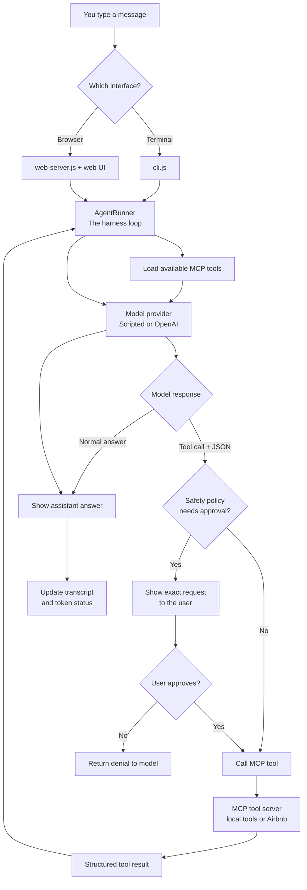

# How One Message Becomes an Agent Action

This is the complete workflow used by both the terminal CLI and the web UI.



## The same flow in plain English

1. You send a message from the CLI or web UI.
2. `AgentRunner` gives the model the conversation and available tool definitions.
3. The model either writes an answer or asks to call a named tool with JSON arguments.
4. The harness checks policy. Sensitive boundaries—such as external data requests and terminal actions—pause for your approval.
5. If you approve, the MCP manager sends the structured call to the correct MCP server.
6. The MCP server returns data or an error.
7. The harness gives that result back to the model.
8. The model writes a user-facing explanation, and the interface renders it.

## The safety boundary

```text
The model can suggest an action.
The harness decides whether it is allowed.
You decide whether approved actions actually run.
```

That separation is the core architecture lesson in this project.
